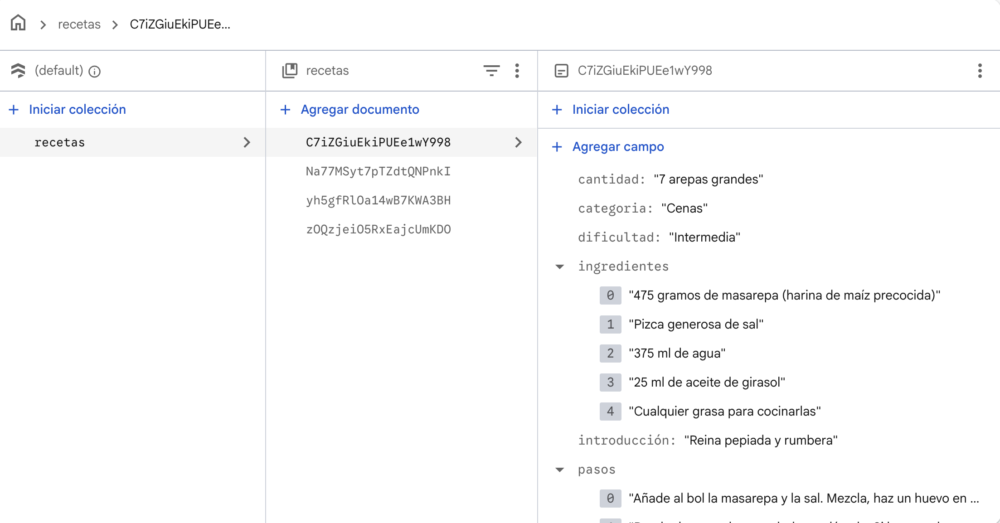
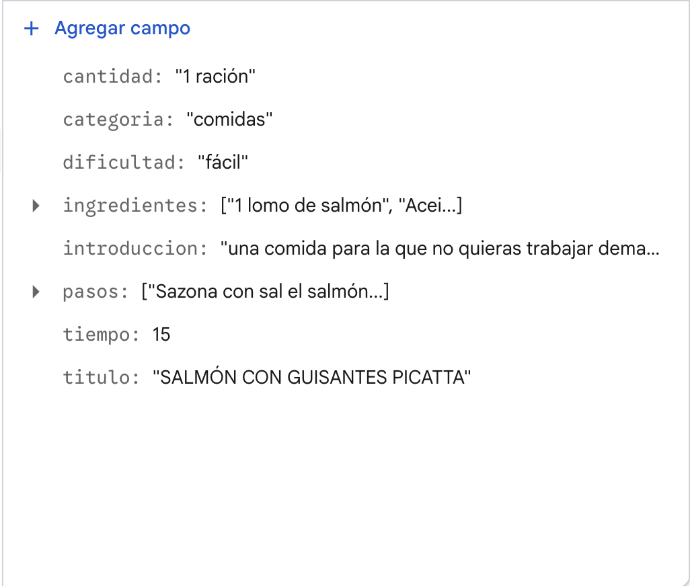
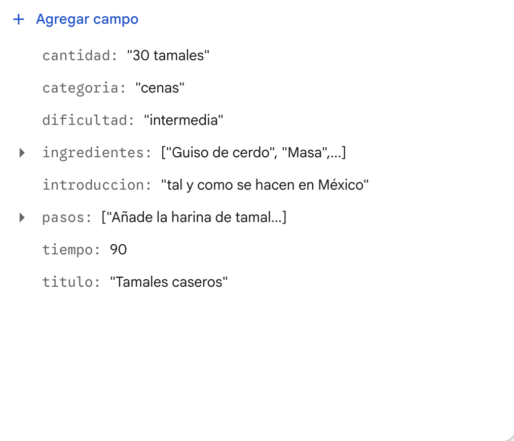
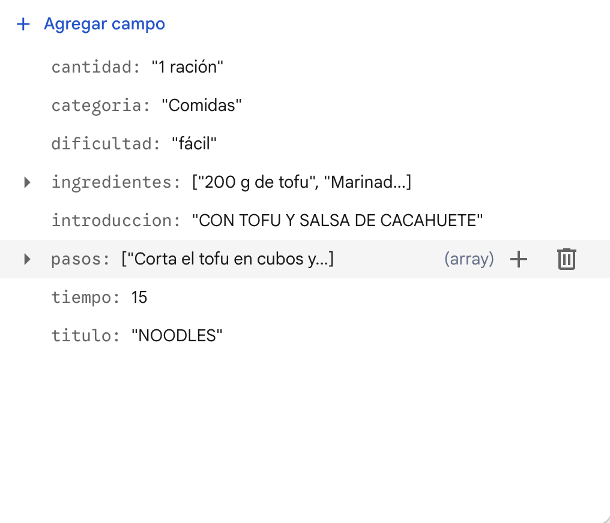
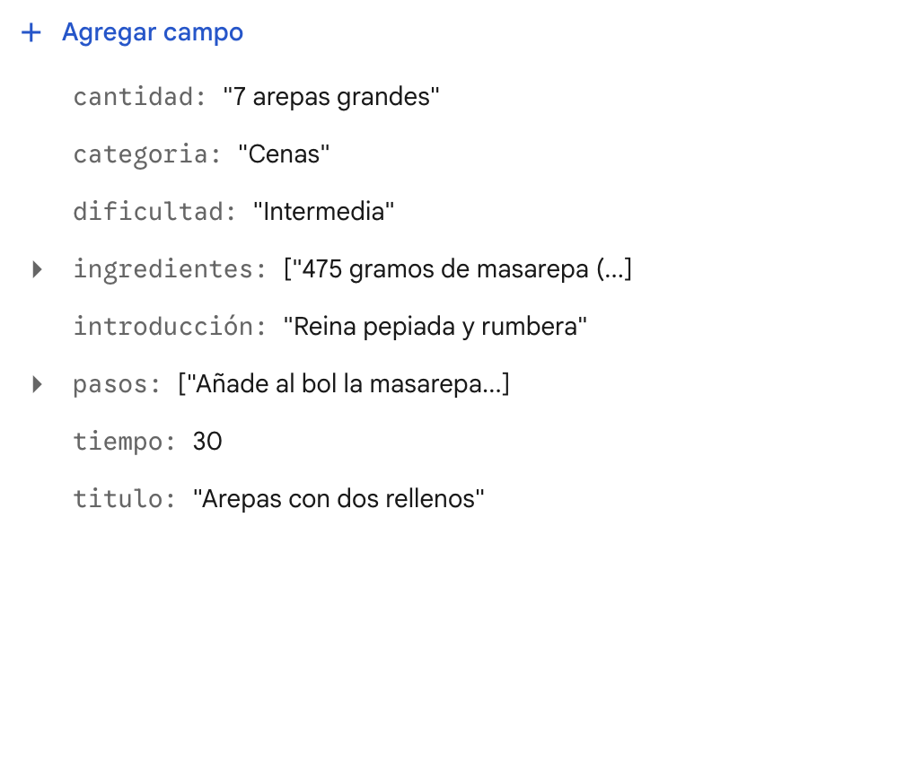

# Receptari – app amb Vue

## Temàtica i descripció

Aplicació web de receptes de cuina feta amb Vue 3, Vue Router i Cloud Firestore. Mostra un receptari amb les receptes guardades a Firestore: títol, categoria, dificultat, temps, ingredients i passos. L'app només llegeix dades; no hi ha altes, modificacions ni eliminacions.

**Tecnologies:** Vue 3 (Vite), Vue Router, Cloud Firestore i Firebase Hosting.

**Web publicada:** https://recetasricasnyam.web.app/

## Instal·lació, execució i desplegament

Requisits: Node.js i Firebase CLI (`firebase login` fet prèviament).

1. Instal·lar les dependències: `npm install`
2. Executar en local: `npm run dev` (obre l'adreça que mostra la terminal, normalment http://localhost:5173)
3. Generar la versió de producció: `npm run build` (crea la carpeta `dist`)
4. Desplegar a Firebase Hosting: `firebase deploy --only hosting`

Les regles de Firestore es despleguen amb `firebase deploy --only firestore:rules`.

Firebase Hosting està configurat amb una reescriptura cap a `/index.html` (a `firebase.json`) perquè Vue Router funcioni en accedir directament a una ruta o en recarregar la pàgina.

## Components propis

| Component | Funció |
|---|---|
| `NavMenu.vue` | Menú de navegació amb `RouterLink` cap a les tres rutes. |
| `RecetaCard.vue` | Mostra una recepta: dades, ingredients i passos. Rep la recepta per props. |
| `MensajeEstado.vue` | Mostra un missatge d'estat (càrrega, sense dades o error). |

## Comunicació amb props

- **Pare:** `RecetasView.vue`. Llegeix la col·lecció `recetas` de Firestore i recorre les receptes amb `v-for`.
- **Fill:** `RecetaCard.vue`. Declara la prop `receta` amb `defineProps` i només la mostra, sense modificar-la.
- **Dades que es passen:** un objecte `receta` amb els camps del document de Firestore (`titulo`, `categoria`, `dificultad`, `tiempo`, `cantidad`, `introduccion`, `ingredientes`, `pasos`), amb `:receta="receta"`.

`RecetasView.vue` també passa les props `texto` i `tipo` a `MensajeEstado.vue` per mostrar els estats de càrrega, sense dades i error.

## Rutes

| Ruta | Vista | Contingut |
|---|---|---|
| `/` | `InicioView.vue` | Pàgina de benvinguda. |
| `/recetas` | `RecetasView.vue` | Llista de receptes llegides de Firestore, amb estat de càrrega, missatge si no hi ha dades i missatge d'error. |
| `/sobre` | `SobreView.vue` | Informació sobre la web. |

## Cloud Firestore

- **Col·lecció:** `recetas`
- **Camps principals:** `titulo` (string), `introduccion` (string), `categoria` (string), `dificultad` (string), `tiempo` (int64, en minuts), `cantidad` (string), `ingredientes` (array de strings), `pasos` (array de strings).
- **Vista que mostra les dades:** `RecetasView.vue` (ruta `/recetas`).
- **Regles:** només lectura; les escriptures estan tancades (`firestore.rules`).

### Captures de l'estructura de dades

Col·lecció `recetas`:

Documents de les receptes:

